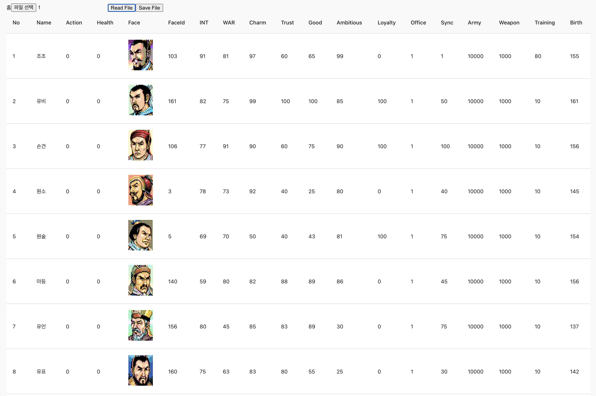

# RoTK2_Editor_React

삼국지2 도스용 (한글판) 에디터

빌드 없이 브라우저에서 바로 여는 HTML 한 파일 (`index.html`)

예전 React (Material UI) 버전은 `index.jsx`로 남아 있습니다.

RoTK2 (DOS) Editor — a single plain HTML file, no build step.

**▶ [에디터 바로 열기 (Open the editor)](https://htmlpreview.github.io/?https://github.com/brokenpc00/RoTK2_Editor_React/blob/main/index.html)**

파일은 브라우저 안에서만 읽고 저장하며 어디에도 올라가지 않습니다.

 

## 사용법

1. `index.html`을 브라우저로 엽니다 (더블클릭).
2. **세이브 파일 열기**: 세이브 파일을 고릅니다. Officers · Rulers · Lands 탭이 열립니다.
3. **게임 리소스 열기**: 게임 폴더의 `KAODATA.DAT`, `MONTAGE.DAT`, `TAIKI.DAT`를 한 번에 고릅니다.
   - `KAODATA.DAT`: 장수 얼굴 (Face 칸, Faces 탭)
   - `MONTAGE.DAT`: 합성 얼굴 (일반 장수)
   - `TAIKI.DAT`: 등장 장수 목록 (Taiki 탭)
4. 칸을 한 번 누르면 파란 테두리로 선택됩니다. 방향키로 셀을 이동하고, Enter 또는 더블클릭으로 편집합니다. 편집 중에는 방향키가 다른 셀로 이동하지 않습니다. 다시 Enter로 확정, Esc로 취소합니다. 바뀐 칸은 노란색으로 표시됩니다.
5. **저장**으로 세이브 파일을, **TAIKI 저장**으로 `TAIKI.DAT`를 내려받습니다. 게임 폴더에 덮어쓰기 전에 원본은 백업해 두세요.

웹 서버로 열면 (예: 게임 폴더에서 `python3 -m http.server`) 같은 폴더의 `.DAT` 파일을 자동으로 읽습니다.

Officers의 Name, INT, WAR, Charm, Loyalty, Sync, Family 등 열 제목을 누르면 오름차순·내림차순으로 정렬합니다. **No**로 번호순으로 돌아갈 수 있습니다. 정렬은 화면에만 적용하며, 저장 파일의 장수 순서와 바이트 위치는 유지됩니다.

Officers의 **Ruler Name** 칸에서 Enter 또는 더블클릭하면 Rulers 목록의 군주를 선택할 수 있습니다. Enter로 확정하면 그 군주가 실제 있는 땅의 장수 목록 끝으로 이동합니다. 이전 목록의 앞뒤 연결과 시작 주소도 함께 갱신합니다. Esc는 취소입니다.

- Loyalty 100, Army 10000, Weapon 10000, Training 100을 자동 설정합니다.
- Sync는 선택한 군주의 값, Family는 Rulers 화면의 군주 번호(1~16)로 설정합니다.
- 같은 군주를 그대로 선택하면 값을 바꾸지 않습니다. 군주 본인의 소속 변경은 지원하지 않습니다.
- 장수 목록의 순환·중복이나 군주의 위치를 확인할 수 없으면 변경을 적용하지 않습니다.

## 수정할 수 있는 항목

| 탭 | 항목 |
|---|---|
| Officers | 이름(한글 3자), 행동, 건강, 얼굴, 지력, 무력, 매력, 의리, 인덕, 야망, 충성, 사관, 상성, 병사, 무장, 훈련, 일족, 소속 군주(목록 선택), Ex1~5 |
| Lands | 금, 쌀, 인구, 토지, 치수, 충성, 명마, 성채, 시세 |
| Taiki | 이름, 얼굴, Family, 상성, 생년, 등장 연도, 등장 지역, 지력~야망, 군주, 충성, 사관, Ex1·Ex2·Ex4 |
| Rulers | 보기만 (동맹 · 우호도) |

- Taiki 탭의 Born · Appear Year · Appear Province는 파일 값에 1을 더해 보여줍니다.
- 군주 번호 254는 신군주 (파일 값 15), 255는 무소속입니다.
- 저장할 때는 바뀐 칸의 바이트만 덮어씁니다. 아무것도 고치지 않고 저장하면 원본과 같은 파일이 됩니다.

## 파일 구조 (한글판)

세이브 파일 (28,960 bytes, 시그니처 `1990.02.19`)

| 위치 | 크기 | 내용 |
|---|---|---|
| 0 | 32 | 헤더 (12~13: 연도, 14: 월-1, 15: 군주 수) |
| 32 | 36 × 255 | 장수 |
| 9212 | 6 | 모름 |
| 9218 | 41 × 16 | 군주 |
| 9874 | 35 × 41 | 지역 |
| 11309 | 나머지 | 모름 |

`TAIKI.DAT` (16,386 bytes): 시나리오별 등장 장수 수 (6) + 등장 장수 (39 × 420)

`KAODATA.DAT` (210,240 bytes): 얼굴 219개 × 960 bytes, 64 × 40 픽셀 8색 (3바이트 = 8픽셀, green / blue / red 순서), 한 줄을 두 줄로 그림

`MONTAGE.DAT` (50,688 bytes): 8세트 × 6,336 bytes, 세트마다 윗면 · 아랫면 · 눈 · 입 · 코 4종씩
