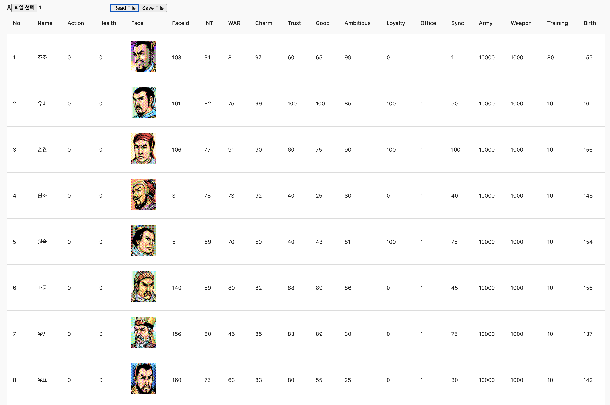

# RoTK2_Editor_React

삼국지2 도스용 (한글판) 에디터

빌드 없이 브라우저에서 바로 여는 HTML 한 파일 (`index.html`)

예전 React (Material UI) 버전은 `index.jsx`로 남아 있습니다.

RoTK2 (DOS) Editor — a single plain HTML file, no build step.

 

## 사용법

1. `index.html`을 브라우저로 엽니다 (더블클릭).
2. **세이브 파일 열기**: 세이브 파일을 고릅니다. Officers · Rulers · Lands 탭이 열립니다.
3. **게임 리소스 열기**: 게임 폴더의 `KAODATA.DAT`, `MONTAGE.DAT`, `TAIKI.DAT`를 한 번에 고릅니다.
   - `KAODATA.DAT`: 장수 얼굴 (Face 칸, Faces 탭)
   - `MONTAGE.DAT`: 합성 얼굴 (일반 장수)
   - `TAIKI.DAT`: 등장 장수 목록 (Taiki 탭)
4. 칸을 눌러 값을 고칩니다. Enter로 확정, Esc로 취소합니다. 바뀐 칸은 노란색으로 표시됩니다.
5. **저장**으로 세이브 파일을, **TAIKI 저장**으로 `TAIKI.DAT`를 내려받습니다. 게임 폴더에 덮어쓰기 전에 원본은 백업해 두세요.

웹 서버로 열면 (예: 게임 폴더에서 `python3 -m http.server`) 같은 폴더의 `.DAT` 파일을 자동으로 읽습니다.

## 수정할 수 있는 항목

| 탭 | 항목 |
|---|---|
| Officers | 이름(한글 3자), 행동, 건강, 얼굴, 지력, 무력, 매력, 의리, 인덕, 야망, 충성, 사관, 상성, 병사, 무장, 훈련, 일족, Ex1~5 |
| Lands | 금, 쌀, 인구, 토지, 치수, 충성, 명마, 성채, 시세 |
| Taiki | 이름, 얼굴, Family, 상성, 생년, 등장 연도, 등장 지역, 지력~야망, 군주, 충성, 사관, Ex1·Ex2·Ex4 |
| Rulers | 보기만 (동맹 · 우호도) |

- Taiki 탭의 Born · Appear Year · Appear Province는 파일 값에 1을 더해 보여줍니다.
- 군주 번호 254는 신군주 (파일 값 15), 255는 무소속입니다.
- 저장할 때는 바뀐 칸의 바이트만 덮어씁니다. 아무것도 고치지 않고 저장하면 원본과 같은 파일이 됩니다.

## 파일 구조 (한글판)

세이브 파일 (28,960 bytes, 시그니처 `1990.02.19`)

| 위치 | 크기 | 내용 |
|---|---|---|
| 0 | 32 | 헤더 (12~13: 연도, 14: 월-1, 15: 군주 수) |
| 32 | 36 × 255 | 장수 |
| 9212 | 6 | 모름 |
| 9218 | 41 × 16 | 군주 |
| 9874 | 35 × 41 | 지역 |
| 11309 | 나머지 | 모름 |

`TAIKI.DAT` (16,386 bytes): 시나리오별 등장 장수 수 (6) + 등장 장수 (39 × 420)

`KAODATA.DAT` (210,240 bytes): 얼굴 219개 × 960 bytes, 64 × 40 픽셀 8색 (3바이트 = 8픽셀, green / blue / red 순서), 한 줄을 두 줄로 그림

`MONTAGE.DAT` (50,688 bytes): 8세트 × 6,336 bytes, 세트마다 윗면 · 아랫면 · 눈 · 입 · 코 4종씩
